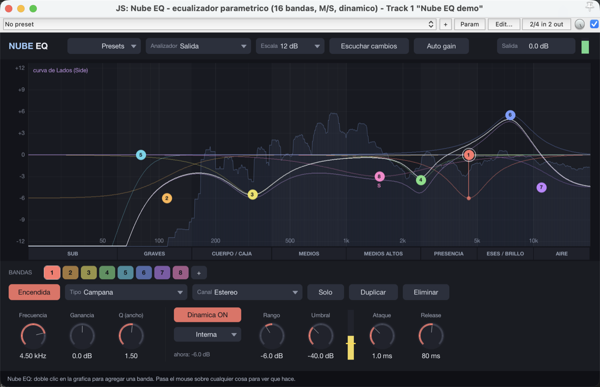

<!-- en -->
# Nube EQ

A free parametric equalizer for [REAPER](https://www.reaper.fm), written as a JSFX (macOS / Windows / Linux), part of the
[Nube plugins](https://github.com/KevinMeneses/nube-plugins).



16 bands, 7 filter types, 6–48 dB/oct slopes, per-band channel (stereo / mid / side / L / R), dynamic bands with external sidechain, solo, delta listen, auto gain, live analyzer with explained frequency zones, and presets. Minimum phase, zero latency, ~0.3 % CPU in the worst case.

**Install** — with [ReaPack](https://reapack.com): *Extensions → ReaPack → Import repositories*, paste
`https://github.com/KevinMeneses/nube-plugins/raw/main/index.xml`, then install **Nube EQ**. Or copy `nube_eq.jsfx`
into `REAPER/Effects/Nube EQ/` (on macOS `./install.sh` links it). It shows up as **JS: Nube EQ**. The interface is in Spanish.

**How it was made** — designed and built with [Claude Code](https://claude.com/claude-code). Since an AI can't
listen, every feature is verified by rendering test cases inside REAPER and comparing them with the theory
(`tests/run.sh`), plus mouse-driven UI tests (`tests/ui_test.py`).

**License** — GPL-3.0-or-later (see `LICENSE`).

---

## Español
Ecualizador paramétrico para REAPER (JSFX, macOS/Windows/Linux), pensado para mezclar voz y beats sin pelearse con la interfaz.


- **Hasta 16 bandas**, se agregan y quitan cuando quieras.
- **7 tipos**: campana, shelf grave, shelf agudo, corte grave (HPF), corte agudo (LPF), notch y pasa banda.
- **Pendientes de corte** de 6, 12, 18, 24, 36 y 48 dB/oct (Butterworth; el Q de un corte es su resonancia).
- **Canal por banda**: Estéreo, Centro (Mid), Lados (Side), Izquierda o Derecha. Así se "separan zonas":
  por ejemplo, bajar 1.5 kHz solo en el centro de un Rhodes y dejar los lados abiertos.
- **Bandas dinámicas**: la banda solo actúa cuando esa zona suena fuerte (de-esser, caja que aparece a ratos).
  Con fuente **Sidechain 3/4** reacciona a otra pista: la voz le abre espacio al Rhodes o a los coros.
- **Solo de banda**: escuchas solo la zona de esa banda (en un corte, lo que estás quitando).
- **Escuchar cambios (Δ)**: suena solo lo que la EQ quita o agrega.
- **Salida y Auto gain**: compensa el volumen para comparar sin engañarte.
- **Analizador** de salida (y entrada), con inclinación de 4.5 dB/oct.
- **Zonas explicadas** debajo de la gráfica (sub, graves, cuerpo/caja, medios, presencia, eses, aire):
  pasa el mouse por encima y abajo aparece qué hay ahí y qué se suele hacer.
- **Presets**, entre ellos la cadena de voz de *Nube baja* sumada en una sola EQ.
- Fase mínima, sin latencia. CPU: el peor caso (16 bandas dinámicas en M/S) usa ~0.3 % de un núcleo.

## Instalar

```sh
./install.sh
```

Crea un enlace en `~/Library/Application Support/REAPER/Effects/Nube EQ/`. En REAPER aparece como
**JS: Nube EQ** en el navegador de FX. Si cambias el código, vuelve a insertar el FX: la instancia
abierta sigue con el código anterior.

## Cómo se usa

| Acción | Cómo |
|---|---|
| Agregar banda | Doble clic en la gráfica (cerca de 20 Hz crea un corte grave, cerca de 20 kHz uno agudo), botón **+**, o clic derecho → elegir tipo |
| Mover | Arrastra el punto: horizontal = frecuencia, vertical = ganancia. **Shift** = fino |
| Ancho (Q) | Rueda del mouse sobre el punto o la perilla Q |
| Encender / apagar | Doble clic sobre el punto, botón *Encendida*, o tecla **B** |
| Borrar | **Alt+clic** sobre el punto, botón *Eliminar*, o tecla **delete** (la de borrar del Mac; la "Supr" de teclado extendido la usa REAPER) |
| Menú de la banda | Clic derecho sobre el punto o su número: tipo, canal, pendiente, dinámica, solo, duplicar |
| Solo | Botón *Solo* o tecla **S** |
| Perillas | Arrastra arriba/abajo o usa la rueda; **Shift** = fino; doble clic = valor por defecto |

En el pie de la ventana siempre hay una ayuda de lo que tienes bajo el mouse.

### Banda dinámica

1. Selecciona una campana o shelf y aprieta **Dinámica**.
2. **Rango**: cuánto se mueve (negativo baja, positivo sube). **Umbral**: desde qué nivel actúa.
   El medidor al lado del umbral muestra el nivel de esa zona; la banda actúa cuando la barra pasa la línea amarilla.
3. **Ataque / Release**: 1 ms / 80 ms para las s; 10 / 200 ms para cosas más suaves.

### Sidechain (abrir hueco a la voz)

1. En la pista del instrumento (Rhodes, coros) pon Nube EQ y elige el preset *Hueco para la voz*.
2. En la pista de la voz, crea un envío hacia el instrumento en los canales **3/4** (la pista destino necesita 4 canales).
3. La banda de Centro baja hasta −5 dB en 1.5 kHz solo mientras cantas.

## Presets

| Preset | Qué hace |
|---|---|
| Voz Tonor - Nube baja (cadena exacta) | La EQ de la voz de *Nube baja* (cadenas *Voz Tonor 1* + *5*) en una sola instancia: HPF 80, shelfs 110 −6 / 200 −4, cuerpo 250–315, 2.5k −3.5 angosto, 3.5k −4.5, de-esser dinámico en 4.5 kHz, aire 7.5k +5.5, shelf 11k −4.5 |
| Voz rap - punto de partida | HPF 85, caja 310 −4, presencia 3k +2, de-esser 6k, aire 10k +2.5 |
| Voz hablada tipo radio / teléfono | Pasa banda 400 Hz–3.5 kHz con 1.5 kHz +4 |
| De-esser | Campana dinámica en 6 kHz, −8 dB |
| Hueco para la voz | Centro 1.5 kHz −5 dB con sidechain 3/4 + Lados 1.5 kHz +1.5 |
| 808 / bajo limpio | HPF 25, shelf 60 +2, 95 Hz −5 |
| Hi-hats y clap sin siseo | HPF 300 suave, shelf 11k −5 |
| Master sutil (Nube baja) | HPF 25, 250 −0.8, 3k +0.9, shelf 10k +1.4 |

Los presets también se pueden elegir desde la lista de parámetros de REAPER ("Cargar preset").
Para guardar los tuyos usa el botón **+** de la ventana del FX (presets normales de REAPER).

## Estructura

- `src/nube_eq.template.jsfx`: el código (DSP + interfaz). **Editar aquí.**
- `tools/build.py`: genera `nube_eq.jsfx` (declara los 198 sliders y el acceso por índice).
- `tests/`: pruebas que corren dentro de REAPER.
  - `tests/run.sh`: arma el plugin, renderiza 30 casos en una pestaña temporal y compara contra la teoría
    (filtros RBJ/Butterworth de scipy, ±0.2 dB): tipos, pendientes, M/S/L/R, 16 bandas, bypass, salida, auto gain,
    Δ, dinámica, sidechain y presets.
  - `tests/ui_demo.lua` / `tests/ui_close.lua`: abren y cierran una pestaña de demo con el plugin y audio.
  - `tests/perf.lua`: mide la CPU en el peor caso.
  - `tests/ui.py` + `tests/ui_dump.lua` + `tests/scroll.swift`: para probar la interfaz con el mouse
    (`cliclick`; la rueda con `swift tests/scroll.swift N`). `ui_dump.lua` lee el estado real de las bandas.
    Probado: doble clic para agregar, arrastrar puntos, rueda (Q y perillas), menús y submenús, presets,
    perillas, chips, Alt+clic, doble clic para apagar, teclas S y delete, Duplicar, Eliminar, +, Salida y zonas.

## Detalles técnicos

- Filtros SVF trapezoidales (Simper): misma respuesta que los biquads RBJ, pero estables al modular
  (frecuencia, ganancia y Q se suavizan en ~25 ms; la dinámica recalcula cada 16 muestras).
- Banda dinámica: detector pasa banda en la frecuencia de la banda (pasa bajos/altos en shelfs), envolvente
  de pico con ataque/release, y ganancia = rango · mín(1, exceso·0.75/|rango|) (≈ 4:1).
- Auto gain: −10·log10 de la potencia media de la curva en 48 puntos log entre 40 Hz y 16 kHz, pesada como el espectro
  de una mezcla (cae arriba de 2 kHz y abajo de 60 Hz), limitado a ±12 dB. No bombea. No se aplica en "Escuchar cambios".
- Trampas de EEL2 que ya mordieron: los nombres de variables **no distinguen mayúsculas** (`B` = `b`),
  no usar notación científica (`1e-9`), y la interfaz corre en otro hilo que el audio (por eso las funciones de
  coeficientes de la interfaz son copias `_ui` y las variables del audio llevan prefijo `a_`).
  REAPER expone los sliders con forma `:log` normalizados 0–1 en `TrackFX_SetParam`.

Nota sobre las pruebas: necesitan REAPER y Python con numpy, scipy y soundfile (`NUBE_PY=/ruta/a/python tests/run.sh`). Los casos con voz o música real usan grabaciones propias que no están en el repo (`tests/signals/`); sin ellas esos casos no se pueden correr.
